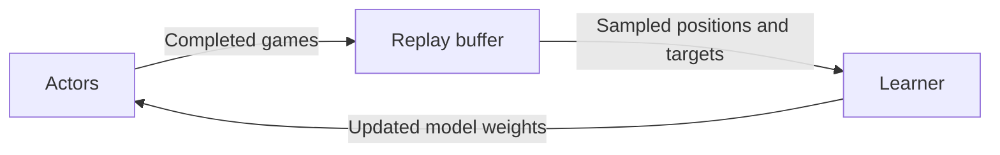

# Architecture

A Zero Systems training run follows the same data flow on a CPU and across several
GPUs. Each actor uses a copy of the model to play games. The coordinator accepts
completed games into replay, schedules learning and publishes updated weights
for subsequent games.

## From a move to a training target

1. An actor gathers observations from its active games. Representation encodes
   each observation into a latent state. Prediction supplies policy logits and
   a value. Each game has its own search tree, so the actor can batch model
   evaluations across games. [Self-play](../src/zero_systems/play.py) · [Model](../src/zero_systems/model.py)
2. PUCT or Gumbel search selects actions to explore. Dynamics predicts successor
   states and rewards inside the search. Once search chooses a move, the actor
   applies it in the environment and records the resulting experience. CPU tree
   operations use Numba. The GPU backend keeps tree operations on the device.
   [Search](../src/zero_systems/search.py) · [GPU tree](../src/zero_systems/search_gpu.py) · [Environment adapters](../src/zero_systems/env.py)
3. Replay samples decision positions uniformly from stored games. The learner
   unrolls the model with actions taken in the game and fits the search policies,
   value targets and, where applicable, transition rewards. Go uses the game
   outcome and a fixed zero reward output. Go symmetries transform observations,
   policy targets and actions together. [Replay and targets](../src/zero_systems/replay.py) · [Learner](../src/zero_systems/learn.py)

## Scheduling and devices

The coordinator can alternate self-play and learning in phases or let them run
concurrently. During asynchronous training, accepted games or positions set the
budget for learner updates. Actors receive finite assignments with game IDs and
a model version. If a remote worker disconnects, the coordinator can reassign
missing games and recognize results it has already accepted.
[Coordinator](../src/zero_systems/run.py) · [Workers](../src/zero_systems/workers.py)

Learning runs on one host. With multiple learner GPUs, each replica processes
a share of the global batch. PyTorch DistributedDataParallel synchronizes the
gradients before each replica takes the same optimizer step. A per-device microbatch limit bounds memory use. Changing the
split can affect batch normalization and therefore the training trajectory even
when the same number of samples contributes to each update.
[Distributed learning](../src/zero_systems/distributed.py)

## Monitoring and recovery

The coordinator writes training metrics to `metrics.jsonl` and can mirror them
to TensorBoard. Evaluation runs on portable snapshots so every game in an
evaluation uses a fixed model. Full checkpoints also save the replay buffer,
optimizer and scheduling state for resuming training. See the [usage guide](usage.md)
for evaluation, rollback and checkpoint commands.
[Storage](../src/zero_systems/storage.py) · [Evaluation](../src/zero_systems/evaluate.py) · [Live evaluator](../src/zero_systems/live.py)

The top-level `source_sha256` in a checkpoint identifies the coordinator’s
Python package. When training starts from another checkpoint, the nested
`initialization.source_sha256` identifies the bytes of that parent file.
For distributed self-play, `remote_actor_connected` entries in `metrics.jsonl`
record the hostname and package fingerprint reported by each connecting node.
Older actors can connect with the same protocol and leave these fields null.

## Board-size transfer

The residual Go model offers two prediction heads. The dense head flattens
spatial features, so some weights depend on board size. The spatial head
produces a policy logit at each point and pools over the board for pass and
value predictions. Its parameter shapes stay fixed across board sizes. The
transformer board model uses the spatial head as well. A transfer run can reuse
representation, dynamics and prediction together or select individual
components. The optimizer and replay start fresh.
[Model and initialization](../src/zero_systems/model.py) · [Transfer settings](usage.md#transfer-a-model)
